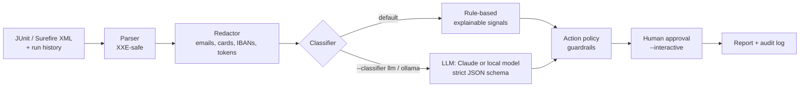

# test-failure-triage-agent

[](https://github.com/deingvard/test-failure-triage-agent/actions/workflows/ci.yml)


An agent that reads failed automated tests from JUnit / Surefire reports, decides **why** each test
failed (product bug, flaky test, environment, test data, broken locator), proposes a safe next step and
**asks a human to approve it**. It works with a transparent rule-based classifier out of the box and can
use an LLM as the classifier (Claude via API, or a free local open model via Ollama), with
deterministic guardrails around it.

All data in this repository is **100% synthetic**. No client, employer or production data is used.

## Why

In a large regression suite, the hard part of a red build is not seeing the failure; it is deciding
what kind of failure it is. Manual triage is slow, and the usual shortcut, "re-run until green",
quietly hides real defects. This project explores how far automated triage can go while keeping one
rule non-negotiable: **a real product bug must never be silenced**.

## What it does



1. **Parse** every failed or errored test case from the reports, together with its log output.
2. **Add run history** (`PPFPPFPP`, oldest first) so instability is judged on evidence, not on wording.
3. **Redact** secrets and personal data locally before anything is sent to an LLM or written to disk.
4. **Classify** into one of five categories with a confidence score and the evidence behind it.
5. **Apply the policy**: the classifier only proposes; the policy decides what is acceptable.
6. **Ask a human** to approve or reject each proposal. Nothing is executed automatically.

| Category | Typical evidence | Proposed action |
|---|---|---|
| `PRODUCT_BUG` | wrong business value, HTTP 500, server-side exception, contract broken | `FILE_BUG` |
| `FLAKY_TEST` | timing and async waits, stale elements, history flips between pass and fail | `RERUN`, `QUARANTINE` |
| `ENVIRONMENT` | connection refused, DNS, TLS, grid without capacity, disk full | `NOTIFY_INFRA` |
| `TEST_DATA` | duplicates, locked or empty test accounts, missing fixtures | `FIX_TEST_DATA` |
| `BROKEN_LOCATOR` | element not found after a front-end release | `UPDATE_LOCATOR` |

## Safety model

| Guardrail | Where |
|---|---|
| A product bug can only lead to `FILE_BUG` or `ESCALATE`, never to `RERUN` or `QUARANTINE` | `ActionPolicy` |
| "Flaky" requires evidence: at least 2 pass/fail switches in history, otherwise escalate | `ActionPolicy` |
| Quarantine requires repeated instability (at least 4 switches), otherwise downgrade to a re-run | `ActionPolicy` |
| Confidence below the threshold (default 0.6) is escalated to a human | `ActionPolicy` |
| LLM output must match a strict schema; anything else becomes `UNKNOWN` and is escalated | `LlmClassifier` |
| Test output is wrapped as untrusted data in the prompt (prompt-injection defence) | `LlmClassifier` |
| Emails, card numbers (Luhn-checked), IBANs, JWTs, bearer tokens, API keys, passwords and IPs are masked | `Redactor` |
| JUnit XML with a DOCTYPE is rejected (XXE protection) | `JUnitXmlReader` |
| Every decision is appended to `results/audit.jsonl` (redacted), with approval status | `TriageCli` |

The policy is tested against an adversarial classifier that labels every failure as flaky with
confidence 1.0 and asks for quarantine: across the whole dataset no product bug gets silenced.

## Quick start

Requirements: Java 21 and Maven 3.9+.

```bash
mvn verify                                   # build, unit tests, dataset quality gates

# triage a JUnit / Surefire report directory
java -jar target/triage.jar report data/sample-report \
     --history data/sample-report/history.json

# same, but approve or reject each proposal
java -jar target/triage.jar report data/sample-report \
     --history data/sample-report/history.json --interactive

# measure quality on the labelled dataset
java -jar target/triage.jar evaluate data/dataset.jsonl
```

Point `report` at your own `target/surefire-reports` directory to triage a real run.

Using the LLM classifier:

```bash
export ANTHROPIC_API_KEY=...            # API billing, separate from a Claude.ai subscription
export TRIAGE_MODEL=claude-sonnet-5-5   # optional
java -jar target/triage.jar evaluate data/dataset.jsonl --classifier llm
java -jar target/triage.jar report data/sample-report --classifier llm --history data/sample-report/history.json
```

Example output:

```text
> PaymentsApiTest#paymentIsIdempotentForSameKey
  category:   PRODUCT_BUG (confidence 0.67, by rules)
  evidence:   assertion on the system's behaviour failed
  evidence:   test was stable before, a new failure points to a change
  proposed:   FILE_BUG - Open a defect for the development team with the failure evidence attached.

> PaymentsApiTest#registerNewCustomer
  category:   TEST_DATA (confidence 0.63, by rules)
  evidence:   entity already exists
  evidence:   fixture file involved
  evidence:   HTTP 409 Conflict
  proposed:   FIX_TEST_DATA - Repair or regenerate the test data / preconditions.
```

## Evaluation

The dataset (`data/dataset.jsonl`) has 50 labelled synthetic failures from a payments domain, 10 per
category. About one in five is deliberately **hard**: their surface signals point to another
category, for example an assertion on a balance that is really caused by an empty seed script, or a
`TimeoutException` caused by a renamed button id. They exist to show where keyword rules stop working.

Rule-based baseline (full report: [`results/evaluation-rules.md`](results/evaluation-rules.md)):

| Metric | Value |
|---|---|
| Accuracy | 88.0% (44/50) |
| Macro F1 | 0.882 |
| Product-bug recall | 1.00 |
| Product bugs silenced | **0** |
| Escalated to a human | 14 |

Four of the six errors are the deliberately hard cases. Every error ends either as a `PRODUCT_BUG`
or as an escalation to a human, which is the safe direction: an unnecessary bug report costs minutes,
a hidden bug costs much more.

### Rules vs LLM

| Metric | Rules | Qwen 2.5 7B, local (Ollama) | Claude API | Target for an LLM |
|---|---|---|---|---|
| Accuracy | **88.0%** | 70.0% | not measured yet | ≥ 95% |
| Macro F1 | **0.882** | 0.674 | — | ≥ 0.95 |
| Hard cases solved | **7 of 11** | 5 of 11 | — | ≥ 10 of 11 |
| Product bugs silenced | **0** | **0** | — | 0 (hard requirement) |
| Escalated to a human | 14 | 1 | — | — |

Numbers in this README are only ever measured, never estimated. Full reports:
[`results/evaluation-rules.md`](results/evaluation-rules.md),
[`results/evaluation-ollama.md`](results/evaluation-ollama.md).

What the local 7B model run showed (same prompt, schema and policy; 50 cases in about 19 minutes on
the free GitHub runner CPU):

- **It is worse than the rules here**: 70% vs 88%. It confuses test-data problems with product bugs
  (7 of 10) and slow UI waits with broken locators (4 of 10 flaky cases).
- **It is overconfident**: 14 of its 15 errors came with confidence ≥ 0.9, so the confidence threshold
  barely helps; it escalated only 1 case, against 14 for the rules.
- **The guardrails still held**: it called one real product bug flaky (`product_bug-09`, confidence 0.80);
  the policy saw no instability in the run history and escalated it instead of re-running.
  Zero product bugs were silenced.

Takeaway: a small local model is not a drop-in replacement for transparent rules, and an LLM without
deterministic guardrails would have hidden a real defect. Rules stay the default; next experiments are
a hybrid mode (LLM only for low-confidence cases), few-shot examples and larger models.

Run it yourself for free: install [Ollama](https://ollama.com), `ollama pull qwen2.5:7b`, then
`java -jar target/triage.jar evaluate data/dataset.jsonl --classifier ollama`. In CI it is the
[`llm-eval`](.github/workflows/llm-eval.yml) workflow (manual dispatch, any Ollama model tag).
The Claude classifier (`--classifier llm`) uses the same command and metrics and needs an
`ANTHROPIC_API_KEY` with API credit.

These numbers are quality gates in `EvaluatorTest`: a change that drops accuracy below 85% or
silences a product bug fails the build.

## Project layout

```text
data/
  dataset.jsonl            labelled synthetic failures (generated)
  generate_dataset.py      generator, re-run to rebuild the dataset
  sample-report/           synthetic Surefire XML + run history
src/main/java/io/github/deingvard/triage/
  TriageCli.java           evaluate / report commands, approval loop, audit log
  model/                   FailureCase, Category, Action, Verdict, Decision
  io/                      JSONL dataset reader, XXE-safe JUnit XML reader
  classify/                RuleBasedClassifier, LlmClassifier, AnthropicClient, OllamaClient
  guard/                   Redactor, ActionPolicy
  eval/                    Evaluator, metrics, Markdown report
src/test/java/...          JUnit 5 + AssertJ tests, incl. a fake LLM transport
.github/workflows/ci.yml   build, tests, evaluation in the job summary
.github/workflows/llm-eval.yml  free LLM evaluation with a local model on the CI runner
```

## Known limitations

- The dataset is small and synthetic; real suites have messier logs and more categories.
- Run history comes from a JSON file; a production version would read it from CI or Allure history.
- The redactor is regex-based: a safety net, not a guarantee.
- Approved actions are recorded, not executed. Creating Jira tickets or moving tests to quarantine
  is out of scope for v0.

## Roadmap

- [ ] Hybrid mode: rules first, LLM only for low-confidence cases (cheaper, faster)
- [ ] Read history from Allure `history-trend` and CI APIs
- [ ] Group failures with the same root cause (one bug, many red tests)
- [ ] Jira / GitLab issue draft for approved `FILE_BUG` decisions
- [ ] Larger dataset with UI screenshots and HTTP traces

## License

[MIT](LICENSE)
